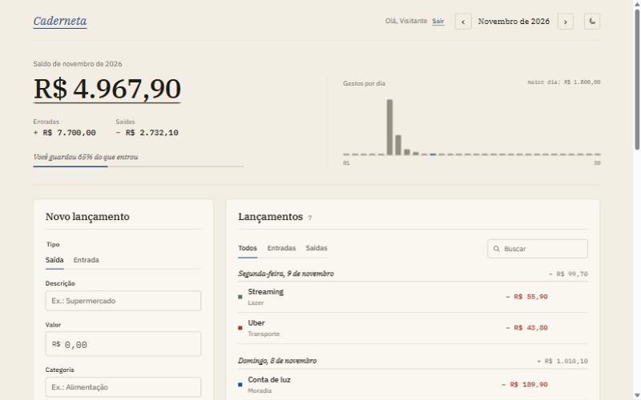
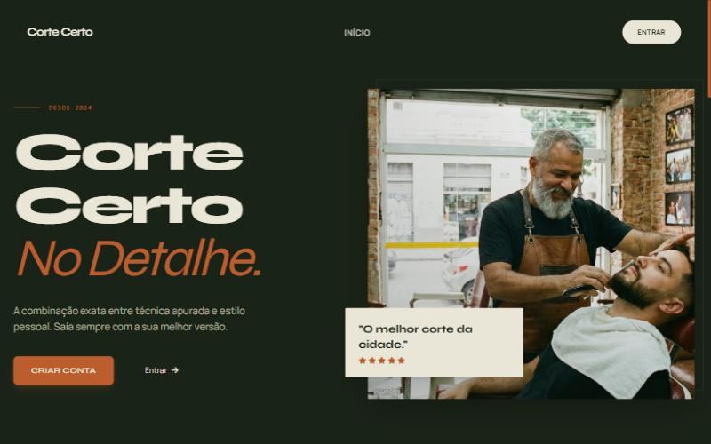

<h1 align="center">Olá, eu sou o Guilherme 👋</h1>

  <b>Desenvolvedor Full Stack Júnior</b> · TypeScript, Node.js e React · São Paulo, SP

  
  
  
  

---

### Sobre mim

Formado em **Análise e Desenvolvimento de Sistemas** pelo Centro Universitário Senac (2025). Trabalho com aplicações web de ponta a ponta: front-end em React, APIs REST em Node.js e bancos de dados relacionais, com testes automatizados e deploy em nuvem.

- 💼 Fui Desenvolvedor Full Stack Júnior na **RF Digital** (2025–2026), onde comecei como estagiário
- 🔨 Hoje evoluo meus projetos pessoais, a **Caderneta** e o **Corte Certo**, os dois no ar

### Tecnologias

  <b>Linguagens</b> 
  

  <b>Front-end</b> 
  

  <b>Back-end e dados</b> 
  

  <b>Testes, nuvem e ferramentas</b> 
  

Também uso Zod, JWT, Supertest, JUnit, Mockito e N8N.

### Projetos em destaque

<table>
  <tr>
    <td width="50%" valign="top">
      
      <h4>Caderneta</h4>
      
Finanças pessoais com cara de caderno de contas: lançamentos, saldo do mês em gráficos e orçamento por categoria com aviso ao estourar.

      
<code>React</code> <code>TypeScript</code> <code>Node</code> <code>Express</code> <code>PostgreSQL</code> <code>Vitest</code>

      
<a href="https://controle-financeiro-lake-six.vercel.app">Ver no ar</a> · <a href="https://github.com/Guilherme7K/controle-financeiro">Código</a>

    </td>
    <td width="50%" valign="top">
      
      <h4>Corte Certo</h4>
      
Agendamento para barbearias com painel administrativo, dashboard de métricas e disponibilidade de horários em tempo real.

      
<code>Python</code> <code>Flask</code> <code>PostgreSQL</code> <code>Tailwind</code>

      
<a href="https://cortecerto-app.vercel.app">Ver no ar</a> · <a href="https://github.com/Guilherme7K/Corte-Certo">Código</a>

    </td>
  </tr>
</table>

Os dois projetos têm conta de demonstração: dá para entrar com um clique e testar tudo.

### Experiência

**RF Digital**
- **Desenvolvedor Full Stack Júnior** · set/2025 – out/2026
  - Aplicações web e websites com React, Node.js e TypeScript
  - APIs REST integradas a serviços externos e bancos de dados
  - Automação de processos internos com N8N
  - Serviços de nuvem (AWS e Google Cloud) e testes automatizados
- **Estagiário de Desenvolvimento** · mar/2025 – set/2025
  - Front-end de sites institucionais e apoio em integrações de back-end
  - DNS, hospedagem, SEO e monitoramento de desempenho
